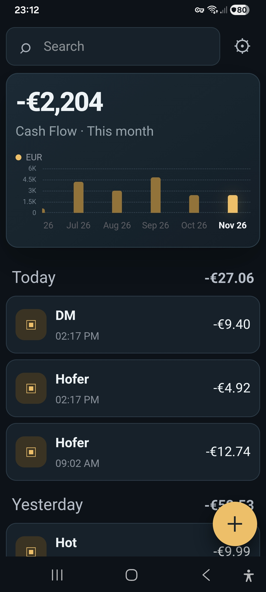
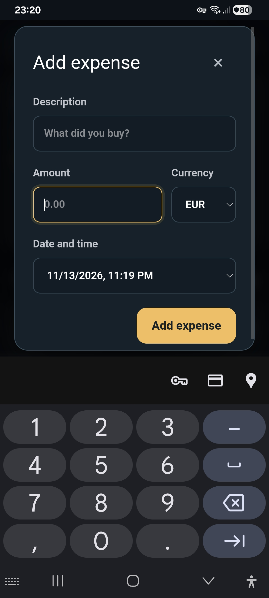
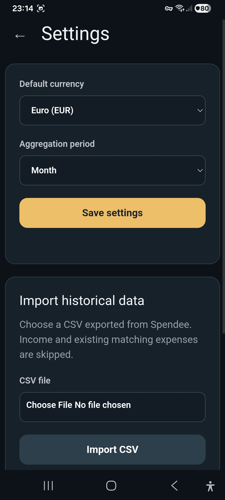

# MySpend

A private, password-protected spending tracker for desktop and mobile. You host it yourself, and all data stays on your server in `data/myspend.sqlite`.

<p align="center">
  
  &nbsp;
  
  &nbsp;
  
</p>
<p align="center"><sub>Cash flow overview &nbsp;·&nbsp; Adding an expense &nbsp;·&nbsp; Settings and CSV import</sub></p>

## Features

- **Quick entry:** tap `+` and enter a description, amount, currency, and date. Tap an expense to edit or delete it.
- **History at a glance:** the chart scrolls horizontally through past periods. Tap a bar to view that period.
- **Your currency, your period:** choose the display currency and aggregation period in Settings.
- **Multi-currency:** amounts are never converted. Each currency gets its own total.
- **Import from Spendee:** load a Spendee CSV export with this column order:

  ```text
  date,wallet,type,category,amount,currency,description,note,account
  ```

  Wallet, type, category, note and account are not stored. Income rows and duplicate expenses are skipped.
- **Export to Spendee format:** Settings also exports a Spendee-compatible CSV. Fields MySpend doesn't store are left empty.

## Setup

```sh
# run the app container as your user and make the data private to it
printf 'MYSPEND_UID=%s\nMYSPEND_GID=%s\n' "$(id -u)" "$(id -g)" > .env
sudo chown "$(id -u):$(id -g)" data/
chmod 700 data/

# generate password (single user)
read -r -s -p 'Password (minimum 20 characters): ' PWA_PASSWORD; printf '\n'
printf '%s\n' "$PWA_PASSWORD" | ./ctrl.sh create_config https://subdomain.example.com
unset PWA_PASSWORD

# configure HTTPS (the token needs Cloudflare DNS edit access, limited to this zone)
printf '%s\n' 'Define APP_DOMAIN subdomain.example.com' > apache/res/domain.conf
(umask 077; mkdir -p apache/secrets; read -r -s -p 'Cloudflare token: ' T; printf '\ndns_cloudflare_api_token = %s\n' "$T" > apache/secrets/cloudflare.ini)
# rerun periodically to renew
./apache/res/ctrl.sh
# or generate a self-signed certificate for local/testing
# ./apache/res/ctrl.sh selfsign

# start the app
docker network inspect proxy >/dev/null 2>&1 || docker network create proxy
docker compose up --build -d --force-recreate
docker compose -f apache/docker-compose.yml up --build -d --force-recreate
```

## Sign out all devices

Deleting `data/sessions.json` and recreating the container signs out every device. Changing the password alone does not.

Change the password and sign out:

```sh
mv config.json config.json.old   # create_config won't overwrite it
read -r -s -p 'New password (minimum 20 characters): ' PWA_PASSWORD; printf '\n'
printf '%s\n' "$PWA_PASSWORD" | ./ctrl.sh create_config https://subdomain.example.com
unset PWA_PASSWORD
rm -f data/sessions.json
docker compose up -d --force-recreate
rm config.json.old               # after checking that the new password works
```

Keep the password and sign out (for example after losing a phone):

```sh
rm -f data/sessions.json
docker compose up -d --force-recreate
```
